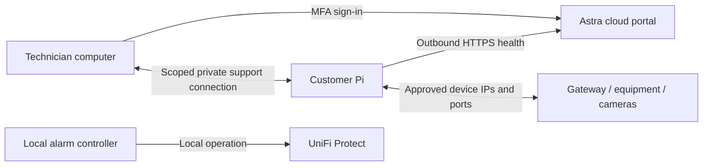

# Remote support through Astra

## Intended experience

Open `astra.example.com`, sign in, pick a named site, see the panel's current
health, and start an authorized support session. The customer continues using
the alarm touchscreen. The technician reaches specifically approved equipment
at that site and ends the session when finished. Every session records operator,
site, allowed targets, start, expiry and end reason. These session controls are
planned; the health portal currently only reads diagnostics.

There is no arm/disarm arrow from the cloud. The remote network path is separate
from the health reporter. Loss of cloud connectivity does not stop local alarm
operation. A failed customer Internet connection will also prevent ordinary
remote access; that case needs an independent connection or an on-site visit.

## Recommended pilot approach

Use an established encrypted overlay, with **Tailscale subnet routing** as the
first candidate to evaluate. It can connect a technician to devices that do not
run the VPN software themselves. Route approval and access policy are separate:
advertising a route does not establish the intended per-technician permissions.
See the [official subnet-router documentation](https://tailscale.com/docs/features/subnet-routers).

The cloud VM hosts the portal and its database; it is not the customer's desktop
and does not need a route into every LAN. Prefer technician-to-site connectivity
so compromise of the fleet database alone cannot browse customer networks.
Confirm the provider's current MSP/commercial arrangement before selecting it
for customer rollout. No VPN account, key, route, or subscription was created.

The first pilot would use one test site and exact destination/port permissions,
with no default all-to-all policy, public port forwarding, exit node, unattended
root SSH, Docker socket access, or broad LAN route granted to all operators.

## Two kinds of "as if on site"

| Need | Intended implementation | Limit |
| --- | --- | --- |
| Open a gateway, switch or device web interface | Private route from the support PC to an approved IP/port | Device still needs its own suitable account; this is not automatically read-only. |
| Troubleshoot a camera | Explicitly authorized camera/Protect viewing account | Viewing video is an additional support scope; never reuse the panel's admin session. |
| Use software that relies on local discovery | A small on-site adapter or isolated support workspace | VPN routing alone is not a promise that Sonos, mDNS or SSDP discovery works. |
| Work inside a browser running on the Pi | Separate unprivileged browser/session | Do not mirror or take over the live alarm kiosk. Benchmark on the 2 GB Pi first. |
| Install panel software | Dedicated signed-release updater | No arbitrary shell or unsigned script delivery through support. Not implemented yet. |

Raspberry Pi Connect is useful for normal remote desktop support, but its screen
sharing shares an existing desktop; it does not create a separate one. That makes
it unsuitable as a direct replacement for an isolated support session on our
Cage alarm kiosk. See [Raspberry Pi Connect documentation](https://www.raspberrypi.com/documentation/services/connect.html).

## Enforcing the no-arm/no-disarm requirement

Hiding buttons in the Astra portal is insufficient. A technician with the panel's
administrator cookie, a full Protect account, an unrestricted terminal, or the
ability to replace panel code could act outside the portal.

The support process therefore needs its own Linux user, network policy and
device accounts. It must not read `/var/lib/loxicom/keypad` or `/etc/loxicom`,
attach to the kiosk browser/session, call local keypad/provisioning APIs, or gain
sudo. Protect access must use a role that cannot change alarm state. If Protect
cannot provide that role for a requested function, leave that function unavailable
until an adequately restricted alternative is verified. Do not ask the customer
to share their administrator login with the support session.

Network allowlists enforce destinations, not application permissions. The Pi's
own management endpoints and loopback addresses must remain inaccessible through
the route. A role that allows a switch reboot should still be constrained to the
selected site's equipment. Rebooting a gateway or PoE port may cut off support;
show this before an explicitly selected device action.

## Site isolation and session lifecycle

- Give every device and site a stable identity and revocable credential.
- Many customers use `192.168.0.0/24`. Give each site's overlapping addresses a
  distinct namespace, or isolate each site in a separate support workspace.
  Tailscale's [4via6 routing](https://tailscale.com/docs/features/subnet-routers/4via6-subnets)
  is one candidate; it maps site identifiers and overlapping IPv4 addresses into
  distinct IPv6 destinations. Do not simply merge all home subnets.
- If choosing 4via6, use a current patched release, at least **1.102.3**, and
  explicitly verify loopback/link-local protections. The provider describes the
  routing fix in its [security bulletins](https://tailscale.com/security-bulletins).
- Require an MFA-authenticated technician assigned to that site. Access starts
  only after customer approval on the panel or an explicit pre-arranged support
  policy. Default sessions should expire after 30 minutes.
- Enforce expiry locally on the site as well as centrally, so a dropped portal
  connection cannot leave a support session open indefinitely. The customer's
  End support action revokes the session immediately.
- Record who accessed which equipment and when. Do not record passwords, PIN
  entry, private camera content or full screen sessions by default.

## Pi resource separation

The current prototype is a Pi 5 with 2 GB RAM. A health reporter is small; a
second graphical browser, video stream or remote desktop is much heavier. Keep
support in a separate service/cgroup with memory and CPU limits, one session at
a time, and local alarm scheduling priority. The shipped health service template
uses a 5% CPU ceiling, 48 MB memory ceiling and a lower scheduling priority.
These are initial settings to measure on a bench, not a performance certification.

Before enabling desktop/video support, measure alarm latency, thermal throttling
and out-of-memory behavior during a loaded session. Start with direct access from
the technician's own PC to selected equipment. A dedicated support appliance is
an option if the customer's support workload outgrows the panel.

## Signed updates

The current keypad verifies and stages signed application releases. Configured
sites still require an attended, independently disarmed update. Complete a
durable activation transaction and power-loss/rollback tests before enabling a
cloud job runner. Cloud operators select approved signed release IDs; they do
not upload executable commands and never receive the release signing key.

Immediately before activation the panel must freshly verify all relevant Protect
profiles are disarmed and that no entry, exit, alert-delivery or recovery work is
pending. A remote job waits when this is unknown or unsafe. It never sends a
disarm command to make an update possible. Preserve PINs, credentials, timers
and customer configuration outside release files, and verify recovery afterward.

## Implementation order

1. Deploy the prepared health portal to the new cloud server; verify real OIDC
   sign-in/MFA, backups and restore, HTTPS and per-device enrollment on a bench.
2. Add customer support approval and local expiry, then commission one scoped
   private route with a limited equipment account. Test cross-site denial and
   revoke/expiry during network loss.
3. Add session auditing and a site-specific Connect action to the portal.
4. Complete signed unattended update recovery on a spare configured panel,
   including interrupted activation and preserved entry state.
5. Evaluate a separate on-site browser/workspace and device-specific discovery
   integrations, keeping the alarm kiosk responsive throughout.

The portal and health protocol are implemented in this preparation. Items 2–5
are design and follow-on work; no live remote-access or update connector exists.
